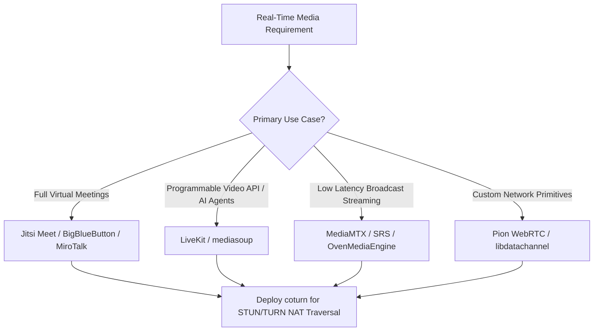

# 🎥 Awesome WebRTC & Real-Time Video

**A comprehensive, curated collection of top-tier SaaS platforms, programmable CPaaS APIs, and open-source infrastructure powering WebRTC, Selective Forwarding Units (SFUs), ultra-low-latency live streaming, and conversational AI video agents.**

  
  
  
  
  
  
  
  

---

## 📑 Table of Contents

- [🌟 Introduction & Key Concepts](#-introduction--key-concepts)
- [📊 Sector Overview & Market Dynamics](#-sector-overview--market-dynamics)
- [☁️ SaaS & Hosted Platforms](#️-saas--hosted-platforms)
- [💻 Open-Source GitHub Projects](#-open-source-github-projects)
  - [🏆 Top Repositories (Ranked by Stars)](#-top-repositories-ranked-by-stars)
  - [🎛️ SFU & Media Server Architecture Guide](#️-sfu--media-server-architecture-guide)
- [🤝 How to Contribute](#-how-to-contribute)
- [💖 Support & Community](#-support--community)
- [📈 Star History](#-star-history)
- [📜 License & Disclaimer](#-license--disclaimer)

---

## 🌟 Introduction & Key Concepts

**WebRTC (Web Real-Time Communication)** is the foundation of interactive multimedia on the modern web, enabling direct peer-to-peer audio, video, and arbitrary bidirectional data transmission with sub-500ms latency without plugins.

Building production real-time video applications requires specialized topologies and protocols:
- **SFU (Selective Forwarding Unit)**: Receives video and audio streams from each participant and forwards them selectively to others without transcoding, optimizing server CPU while saving client upload bandwidth.
- **MCU (Multipoint Control Unit)**: Decodes, composites, and transcodes all participant feeds into a single unified stream, ideal for legacy endpoints at the expense of high compute overhead.
- **P2P Mesh**: Every participant sends direct streams to every other peer; lightweight for 2–4 participants but scales quadratically in bandwidth ($O(N^2)$).
- **NAT Traversal (STUN / TURN / ICE)**: Interactive Connectivity Establishment (ICE) traverses enterprise firewalls and symmetric NATs using Session Traversal Utilities for NAT (STUN) and Traversal Using Relays around NAT (TURN).
- **Multimodal AI Agents**: The latest frontier where WebRTC data channels and audio tracks connect directly to LLMs, speech-to-speech models, and computer vision pipelines in real time.

---

## 📊 Sector Overview & Market Dynamics

The global **WebRTC and Real-Time Video Communication market** is valued at approximately **$9.5 Billion in 2026** and is projected to expand to over **$35.2 Billion by 2032**, compounding at an aggressive **CAGR of ~24.5%**. Growth is catalyzed by remote healthcare consultations, interactive gaming, live broadcast shopping, and real-time voice/video generative AI agents.

The sector demonstrates a **moderately fragmented ecosystem with bi-modal concentration**: mega-cap telecommunications and unified-communications leaders (Zoom, Twilio, Ericsson/Vonage, Agora) control high-volume CPaaS infrastructure and enterprise compliance tiers, while high-velocity developer-first startups (LiveKit, Daily, 100ms) and established open-source engines (Jitsi, SRS, MediaMTX, mediasoup) capture developer mindshare in programmable video, open-source self-hosting, and multimodal AI streaming.

---

## ☁️ SaaS & Hosted Platforms

The table below compiles leading hosted platforms and programmable video APIs. Sorted strictly by **Company Size (Market Capitalization / Valuation / Revenue)** in descending order:

| 🏢 Platform / Product | 🏛️ Company Size (Valuation / Revenue) | 💵 Starting Tier Pricing | 🎁 Free Tier Limit | 🚀 Key Capabilities & Highlights |
| :--- | :--- | :--- | :--- | :--- |
| **[Zoom Video SDK](https://explore.zoom.us/en/video-sdk/)** | **$21.4B Market Cap** ($4.53B Annual Revenue; NASDAQ: `ZM`) | **$0.0035 / participant min** (pay-as-you-go) | **10,000 participant minutes/month** free forever | Global media routing backbone, 1080p video, AI-powered noise reduction, breakout rooms, and battle-tested mobile/web SDKs. |
| **[Twilio Video API](https://www.twilio.com/en-us/video-sdk)** | **$11.8B Market Cap** ($4.15B Annual Revenue; NYSE: `TWLO`) | **$0.0040 / participant min** (Group Rooms up to 50 peers) | **$15.00 trial credit** (~3,750 group participant mins) upon signup | Deep integration with Twilio voice, SMS, and global telephony network; enterprise HIPAA BAA compliance for telehealth. |
| **[Dolby.io Real-Time Comms](https://dolby.io/)** | **$7.2B Market Cap** ($1.30B Annual Revenue; NYSE: `DLB`) | **$0.0045 / participant min** (Video API) / $0.0005/min (Millicast streaming) | **$50.00 free credit** (~11,100 video mins), valid 30 days | Studio-grade Dolby Voice audio processing, active noise suppression, spatial audio positioning, and sub-500ms broadcast. |
| **[Vonage Video API](https://www.vonage.com/communications-apis/video/)** | **$6.2B Acquisition Valuation** (~$1.50B Division Rev; Parent: Ericsson) | **$9.99 / month base fee** + **$0.0040 / participant min** | **$10.00 free trial credit** valid for 30 days upon developer signup | Formerly TokBox OpenTok; battle-tested SIP interconnect, cloud archiving, broadcast mode, and banking/healthcare compliance. |
| **[Agora Real-Time Video](https://www.agora.io/)** | **$340M Market Cap** (~$142M Annual Revenue; NASDAQ: `API`) | **$0.00399 / participant min** (HD 720p) / $0.00199/min (SD) | **10,000 free minutes/month** free forever (audio + video combined) | Software-Defined Real-Time Network (SD-RTN™) across 200+ global PoPs, interactive live broadcasting, and low-latency gaming voice. |
| **[Daily Video & Audio APIs](https://www.daily.co/)** | **$250M Valuation** ($60M+ VC raised: Tiger Global, Lachy Groom) | **$0.0015 / participant min** (Standard) / $0.0040/min (HD) on Launch | **10,000 participant minutes/month** free forever + 100 recording mins | Daily Prebuilt embed widgets, custom canvas layout engine, Daily Bots real-time voice AI pipelines, and global mesh-SFU routing. |
| **[LiveKit Cloud](https://livekit.io/cloud)** | **$150M Valuation** ($22M+ Series A: Altimeter, Redpoint) | **$0.0040 / participant min** (or $0.0005 per bandwidth min) | **10,000 participant minutes/month** (or 50 GB transfer) free forever | 100% open-source parity, LiveKit Agents multimodal AI ecosystem, global geo-distributed SFU mesh, E2EE, and session analytics. |
| **[100ms Live Infrastructure](https://www.100ms.live/)** | **$100M Valuation** ($24M+ Series A: Accel, Falcon Edge) | **$0.0040 / participant min** on Starter plan | **10,000 participant minutes/month** free forever | Pre-built templates, dynamic role management, RTMP/HLS live streaming egress, server-side composite recording, and rich UI kits. |
| **[Whereby Embedded](https://whereby.com/information/embedded)** | **$30M Valuation** (~$18M ARR; Backed by Point Nine Capital) | **$9.99 / month flat** (includes 2,000 mins; overage $0.0040/min) | **2,000 participant minutes/month** free forever (up to 200 rooms) | Instant zero-code iframe or web component embedding, custom domain branding, and frictionless client-side integration. |
| **[Dyte Video SDK](https://dyte.io/)** | **$20M Valuation** ($4.5M+ Seed: Y Combinator, Nexus) | **$0.0040 / participant min** on Pay-As-You-Go | **10,000 participant minutes/month** free forever | In-call collaborative apps (whiteboard, code editor, polling), multi-platform SDKs (React, Flutter, Android, iOS, React Native). |

---

## 💻 Open-Source GitHub Projects

Open source is the driving heartbeat of the WebRTC ecosystem. From production-grade SFU routing servers to cross-platform mobile bindings and NAT traversal servers, these open tools empower complete self-hosting without vendor lock-in.

### 🏆 Top Repositories (Ranked by Stars)

Repositories are strictly sorted descending by **GitHub Stargazers Count**:

1. **[Jitsi Meet](https://github.com/jitsi/jitsi-meet)**   
   *Secure, Simple, and Scalable Video Conferences*  
   The world's most popular open-source video conferencing stack. Features a complete web application, mobile SDKs, end-to-end encryption support, screen sharing, and seamless multi-party calling powered by Jitsi Videobridge.

2. **[SRS (Simple Realtime Server)](https://github.com/ossrs/srs)**   
   *High-Performance Real-Time Video & WebRTC Cluster*  
   Industrial-grade open-source video server supporting WebRTC, RTMP, HLS, HTTP-FLV, and SRT. Extensively used in carrier-grade live streaming broadcasts, sub-second latency video ingestion, and conversational AI voice/video pipelines.

3. **[LiveKit](https://github.com/livekit/livekit)**   
   *End-to-End Realtime Stack for Humans and AI*  
   State-of-the-art Go-based WebRTC SFU and cross-platform client SDKs. Designed for high performance, distributed clustering, Webhooks, end-to-end encryption, and real-time multimodal AI agents with the LiveKit Agents framework.

4. **[MediaMTX](https://github.com/bluenviron/mediamtx)**   
   *Zero-Dependency Multi-Protocol Real-Time Media Server*  
   High-performance media router and proxy written in Go. Publishes, reads, and proxies video/audio streams across WebRTC, RTSP, RTMP, HLS, SRT, and Media-over-QUIC with zero external dependencies.

5. **[Pion WebRTC](https://github.com/pion/webrtc)**   
   *Pure Go Implementation of the WebRTC API*  
   A complete, high-performance WebRTC implementation written in native Go with zero CGO dependencies. The foundation for custom SFUs, IoT video pipelines, robot telemetry, and server-side media gateways.

6. **[WebRTC Samples](https://github.com/webrtc/samples)**   
   *Official WebRTC API Demos and Reference Samples*  
   The canonical sample repository maintained by the WebRTC team. Demonstrates `getUserMedia`, `RTCPeerConnection`, `RTCDataChannel`, screen capture, audio constraints, and video canvas manipulation.

7. **[coturn](https://github.com/coturn/coturn)**   
   *Free Open Source TURN and STUN Server*  
   The indispensable backbone of WebRTC NAT traversal. Implements STUN (RFC 5389), TURN (RFC 5766), and ICE (RFC 5245) protocol relays to guarantee peer connectivity across strict enterprise firewalls and symmetric NATs.

8. **[PeerJS](https://github.com/peers/peerjs)**   
   *Simple Peer-to-Peer WebRTC in the Browser*  
   A developer-friendly JavaScript library wrapping browser WebRTC primitives into a clean event-driven P2P API. Perfect for rapid prototyping of peer-to-peer data channels, voice chats, and video calls.

9. **[Owncast](https://github.com/owncast/owncast)**   
   *Self-Hosted Live Video Streaming & Community Chat*  
   An independent, single-binary live streaming and chat server. Serves as a private, decentralized alternative to Twitch and YouTube Live with RTMP/WebRTC ingestion and built-in interactive chat overlays.

10. **[BigBlueButton](https://github.com/bigbluebutton/bigbluebutton)**   
    *Complete Open-Source Virtual Classroom Platform*  
    Feature-rich web conferencing software optimized for online learning and tutoring. Includes multi-user whiteboards, breakout rooms, shared notes, polling, and interactive presentation tools.

11. **[Janus Gateway](https://github.com/meetecho/janus-gateway)**   
    *General-Purpose C-Based WebRTC Server*  
    A battle-hardened, modular WebRTC gateway developed in C by Meetecho. Features high-performance plugins for SFU video rooms, audio conferencing, SIP gateways, streaming relays, and No-SIP PBX integrations.

12. **[mediasoup](https://github.com/versatica/mediasoup)**   
    *Cutting-Edge WebRTC SFU for Node.js and Rust*  
    A minimalist, ultra-efficient Selective Forwarding Unit library. The C++ media core handles packet routing with zero transcoding overhead, while high-level Node.js or Rust runtimes control signaling logic and room topology.

13. **[aiortc](https://github.com/aiortc/aiortc)**   
    *WebRTC and ORTC Implementation for Python*  
    Built entirely on top of Python's `asyncio` framework. Essential for integrating computer vision (OpenCV), speech recognition (Whisper), neural network pipelines (PyTorch/TensorFlow), and server-side video generation bots.

14. **[react-native-webrtc](https://github.com/react-native-webrtc/react-native-webrtc)**   
    *WebRTC SDK for React Native Mobile Apps*  
    Cross-platform WebRTC bindings and UI video view components for iOS and Android, allowing React Native developers to build native real-time conferencing mobile applications.

15. **[MiroTalk](https://github.com/miroslavpejic85/mirotalk)**   
    *Free WebRTC P2P & SFU Video Conferencing Service*  
    Self-hostable, modern real-time video conferencing application featuring browser P2P calling, SFU scaling, end-to-end encrypted messaging, interactive whiteboard, and screen recording.

16. **[Ant Media Server](https://github.com/ant-media/Ant-Media-Server)**   
    *Ultra-Low Latency Streaming Engine*  
    Scalable streaming server delivering sub-0.5 second WebRTC playback. Supports dynamic RTMP ingestion, CMAF, HLS, adaptive bitrate streaming, and automatic Kubernetes clustering.

17. **[flutter-webrtc](https://github.com/flutter-webrtc/flutter-webrtc)**   
    *WebRTC Plugin for Flutter Desktop, Mobile & Web*  
    Comprehensive Flutter plugin providing hardware-accelerated WebRTC rendering for iOS, Android, macOS, Windows, Linux, and Web from a single Dart codebase.

18. **[OvenMediaEngine](https://github.com/OvenMediaLabs/OvenMediaEngine)**   
    *Sub-Second Latency Live Streaming Server*  
    Open-source streaming server built from scratch in C++. Ingests RTMP, SRT, RTSP, and WebRTC, then broadcasts sub-second streams to thousands of concurrent viewers via WebRTC and Low-Latency HLS (LL-HLS).

19. **[Jitsi Videobridge](https://github.com/jitsi/jitsi-videobridge)**   
    *High-Capacity WebRTC Compatible Video Router*  
    The Java-based Selective Forwarding Unit at the core of Jitsi Meet. Routes video channels between thousands of conference participants without CPU-intensive decoding/encoding.

20. **[libdatachannel](https://github.com/paullouisageneau/libdatachannel)**   
    *Standalone C/C++ WebRTC Data Channel and Media Library*  
    Lightweight, clean C/C++ implementation of WebRTC data channels, WebRTC media transport, and WebSocket connections with minimal external dependencies.

21. **[OpenVidu](https://github.com/OpenVidu/openvidu)**   
    *Developer-Friendly Platform for Video Calling*  
    Wraps modern SFU media servers (mediasoup/Kurento) into high-level REST APIs and frontend libraries (Angular, React, Vue, iOS, Android), dramatically simplifying custom video app delivery.

22. **[Galène](https://github.com/jech/galene)**   
    *Lightweight Videoconference Server in Go*  
    An easy-to-deploy, high-performance SFU videoconference server designed for academic lectures and research conferences with built-in chat, screen sharing, and audio recording.

23. **[Kurento](https://github.com/Kurento/kurento)**   
    *Programmable WebRTC Media Server with OpenCV & GStreamer*  
    A flexible media server platform allowing developers to construct modular media pipelines with real-time computer vision filters, recording modules, and audio/video mixing.

---

### 🎛️ SFU & Media Server Architecture Guide

When designing real-time video architecture, choose the right open-source tool for your operational model:

- **Out-of-the-Box Meetings**: Use **Jitsi Meet** or **BigBlueButton** for ready-to-run UI, moderation, and screen sharing.
- **Developer-First Embedded Video**: Choose **LiveKit** or **mediasoup** for granular programmatic stream subscription and AI agent pipelines.
- **Ultra-Low Latency Streaming (<1s)**: Choose **MediaMTX**, **SRS**, or **OvenMediaEngine** for sub-second ingest and WebRTC egress to massive audiences.
- **NAT Traversal Requirement**: Always deploy **coturn** with authenticated ephemeral credentials to ensure reliable peer connection setup across restricted corporate firewalls.

---

## 🤝 How to Contribute

We welcome contributions from the developer and real-time streaming community! To submit additions or updates:

1. **Fork the Repository** on GitHub.
2. **Add or Edit Entries** in [README.md](README.md) following the existing Markdown table / list format.
3. **Verify Guidelines**:
   - Provide the project name, active official repository or website URL.
   - For SaaS products, include exact pricing tier figures and precise free plan/trial limits.
   - Keep descriptions concise, factual, and technical.
4. **Submit a Pull Request** with a descriptive summary of your contribution.

---

## 💖 Support & Community

If you found this curated list helpful for building real-time video applications, please consider supporting the project:

- ⭐ **Star this repository** to help other developers discover these resources.
- 🍴 **Fork and contribute** to keep the pricing data and open-source lists up-to-date.
- 📢 **Share** with colleagues and video engineering communities.
- ☕ **Sponsor or Buy a Coffee**: Support maintenance and open-source curation via the [GitHub Sponsors Dashboard](https://github.com/sponsors/ishandutta2007).

---

## 📈 Star History

---

## 📜 License & Disclaimer

- **License**: Released under the [MIT License](LICENSE).
- **Disclaimer**: This curated compilation is community-driven for educational and informational purposes. Product pricing, features, and limits change frequently; always consult official vendor documentation for up-to-date service contracts.
